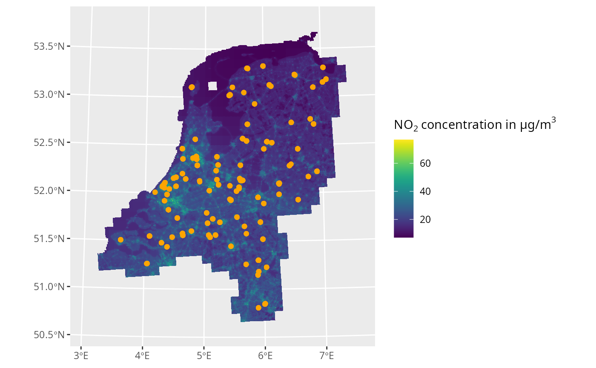

# Spacial plotting

This article describes the method to plot the spacial data underlying
postcodElapse. To enable spatial plotting in R, installation of of the R
packages [tidyverse](https://tidyverse.org/),
[tidyterra](https://dieghernan.github.io/tidyterra/articles/tidyterra.html)
and [ggpubr](https://rpkgs.datanovia.com/ggpubr/) is required.

### ELAPSE

First, a map with the spatial relations of the postal codes is required.
In postcodElapse, ELAPSE is the best equivalent, which can be loaded and
plotted as indicated below:

``` r

library(tidyverse)
library(tidyterra)
library(ggpubr)
library(postcodElapse)

elapse <- loadElapse()

ggplot() +
  geom_spatraster(data = elapse) +
  facet_wrap(~ lyr)
#> <SpatRaster> resampled to 500490 cells.
```


When plotting pass spacial data directly into a geom via the *data*
argument. Plotting a specific layer of ELAPSE can be done with the `$`
operator. Tidyterra’s
[`geom_spatraster()`](https://dieghernan.github.io/tidyterra/reference/geom_spatraster.html)
maps values extracted from spatrasters to the fill aestetic, to scale
the fill colour use
[`scale_fill_grass_c()`](https://dieghernan.github.io/tidyterra/reference/scale_grass.html).

## Plotting postal coded geo-locations

To plot the location of postcodes on ELAPSE the geo-location is
*required* these are provided trough:
[`pollutionFromBag()`](https://griac-bioinformatics.github.io/postcodElapse/reference/pollutionFromBag.md)
and
[`pollutionFromPc6()`](https://griac-bioinformatics.github.io/postcodElapse/reference/pollutionFromPc6.md).
These function output spacial data in the `geom` column. Plotting this
data can be done with
[`geom_sf()`](https://ggplot2.tidyverse.org/reference/ggsf.html), see
the block below.

``` r

data("oneHunderdAddresses")

pc6 <- pollutionFromPc6(oneHunderdAddresses, "../../../data/GeoPackages/cbs_pc6_2024.gpkg")
#> Guessed db type to be: PC6
bag <- pollutionFromBag(oneHunderdAddresses, "../../../data/GeoPackages/bag-light.gpkg")
#> Guessed db type to be: BAG

ggplot() +
  geom_spatraster(data = elapse$NO2FULL) + 
  geom_sf(data = pc6, aes(geometry = geom), fill = "purple", alpha = 0.7) +
  geom_sf(data = bag, aes(geometry = geom), colour = "orange") +
  scale_fill_grass_c() +
  labs(fill = bquote("NO"[2]~"concentration in µg/m"^3))
#> <SpatRaster> resampled to 500490 cells.
```



With this material you can plot the spacial data of postcodes and
ELAPSE. To see all plotting options we recommend the documentation of
[ggplot](https://ggplot2.tidyverse.org/),
[tidyterra](https://dieghernan.github.io/tidyterra/articles/tidyterra.html)
and [ggpubr](https://rpkgs.datanovia.com/ggpubr/index.html_)
